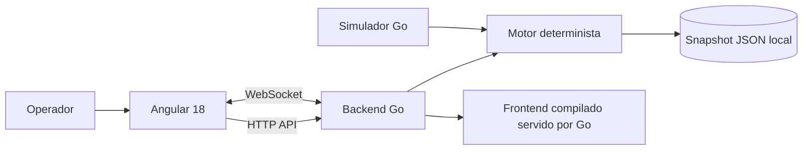
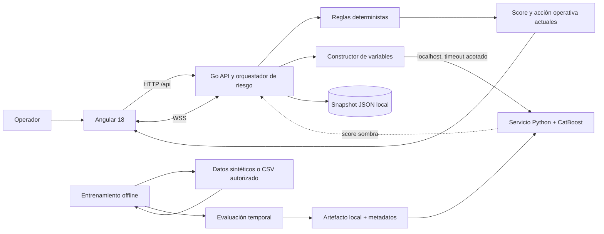

# Arquitectura de ShieldGuardAI

**Estado del documento:** arquitectura actual e integración experimental  
**Actualizado:** 13 de noviembre de 2026

## Resumen ejecutivo

ShieldGuardAI es hoy una demo educativa de una consola antifraude: Angular 18 presenta eventos simulados; un backend Go aplica reglas deterministas, transmite eventos por WebSocket y persiste el estado en un archivo JSON local. Se implementó un servicio CatBoost experimental opcional y se entrenó localmente con datos sintéticos para comprobar el pipeline; ese artefacto local no está versionado ni representa rendimiento antifraude real. No existe integración bancaria.

La evolución conserva Go como API y orquestador. El servicio de inferencia privado en Python con CatBoost, la canalización offline de entrenamiento/evaluación y la conexión opcional desde Go ya están implementados. Se ejecutaron con 12.000 filas sintéticas. El modelo propone una señal exploratoria y motivos; las reglas actuales determinan la acción. PostgreSQL y almacenamiento transaccional siguen pendientes para una futura operación multiusuario.

## Arquitectura implementada hoy



### Componentes actuales

- **Frontend:** aplicación Angular 18; el paquete estático se sirve desde el backend Go.
- **API y tiempo real:** Go `net/http`, rutas REST y WebSocket con Gorilla WebSocket.
- **Evaluación de riesgo:** reglas de monto, canal, MCC, ubicación y estado de tarjeta; no es ML.
- **Simulación:** genera transacciones y permite inyectar escenarios definidos para la demo.
- **Persistencia:** snapshot JSON local para perfiles, transacciones, alertas y acciones. Es de una instancia y no ofrece transacciones concurrentes ni almacenamiento multiusuario.
- **ML opcional:** `ml-service/` contiene contrato de variables, generador sintético, entrenamiento temporal y servidor HTTP CatBoost; Go lo consulta si se configura `SHIELDGUARD_ML_URL`. La respuesta se adjunta como `mlPrediction` y se muestra solo en el detalle de alertas.
- **Despliegue de demo:** un binario Go y frontend estático; `start_demo` inicia el servidor local.

### Límites actuales

El score refleja ponderaciones de reglas, no una probabilidad estadística calibrada. `IsSuspicious` sirve para inyectar escenarios y **no debe convertirse en la etiqueta objetivo de entrenamiento**. El servidor de demo no tiene autenticación ni autorización de operador y no debe exponerse públicamente ni procesar datos bancarios reales.

## Flujo implementado con ML experimental



### Responsabilidad de cada pieza

1. **Angular:** muestra score operativo y, si Go lo recibió, un panel separado para la señal CatBoost. No calcula ninguno de los scores.
2. **Go API/orquestador:** valida la transacción, construye las variables, consulta opcionalmente el servicio ML, conserva las reglas como fuente de decisión, registra el estado y emite eventos WebSocket. La autenticación de operador sigue pendiente.
3. **Servicio ML privado:** `ml-service/service.py` carga una versión del modelo desde `ml-service/artifacts`, valida el contrato y responde con score experimental, versión, alcance del dataset y códigos de razón. En el prototipo enlaza a `127.0.0.1`; no recibe número de tarjeta y no debe exponerse a una red.
4. **Política de riesgo:** hoy conserva las reglas deterministas para `APPROVE`, `FLAG_REVIEW` o `PROACTIVE_FREEZE`. La salida CatBoost es sombra y no altera umbrales ni acciones.
5. **Entrenamiento offline:** `generate_demo_data.py` genera datos ficticios y `train.py` valida el esquema, ordena por tiempo, ajusta CatBoost y guarda artefacto, importancia de variables y metadatos. Permite mostrar iteraciones con `--verbose`. Actualmente usa el último 20% como `eval_set` para early stopping y calcula las métricas sobre ese mismo bloque; por eso sus métricas no provienen de un test independiente. No reentrena durante una transacción ni aprende de una reversa.
6. **Persistencia y auditoría:** el JSON sigue siendo el almacenamiento actual. PostgreSQL, registro de decisiones completo y control de versiones de modelos para operación quedan pendientes.

### Contrato de inferencia implementado

Endpoint interno entre Go y el servicio ML:

```http
POST /internal/v1/predict
```

Entrada implementada: `amount_clp`, `amount_vs_baseline`, `tx_count_card`, `minutes_since_last_tx`, `channel`, `mcc`, `city_changed`. Estos campos describen la demo y deben revisarse/versionarse antes de cualquier piloto.

Respuesta conceptual:

```json
{
  "experimentalScore": 61.2,
  "modelVersion": "catboost-demo-<version>",
  "modelScope": "synthetic",
  "probabilityCalibrated": false,
  "reasonCodes": ["amount_above_customer_baseline"]
}
```

`experimentalScore` es una puntuación porcentual del clasificador, no una probabilidad calibrada. La respuesta informa el alcance y el estado de calibración. La puntuación solo es demostrativa con el artefacto sintético actual. El contrato de características se debe versionar para evitar diferencias entre entrenamiento e inferencia.

## Estrategia ML propuesta

- **Tarea:** clasificación binaria de transacciones, con etiqueta confirmada y definición operacional acordada con un futuro socio financiero.
- **Modelo candidato:** CatBoost como primer modelo de árboles potenciados para atributos numéricos y categóricos; comparar contra una regresión logística interpretable como baseline.
- **Datos:** comenzar con un conjunto aprobado, anonimizado/tokenizado y con etiqueta de adjudicación. Datos sintéticos o de benchmark sirven para demostrar el pipeline académico, no para afirmar eficacia en bancos chilenos.
- **Variables candidatas:** monto relativo a la mediana histórica, velocidad en ventanas 5 min/1 h/24 h, antigüedad o novedad del comercio, canal, MCC, tiempo desde la última compra y cambio geográfico. Excluir identificadores directos, variables posteriores a la decisión y marcas de escenarios simulados.
- **Separación:** partición temporal de entrenamiento, validación y prueba; evitar separar transacciones del mismo período aleatoriamente si eso deja filtrar patrones temporales.
- **Métricas:** PR-AUC, recall a un límite de falsos positivos operativo, precisión en la cola revisada, calibración y latencia. Accuracy sola no representa el costo de clases desbalanceadas.
- **Explicabilidad:** códigos de razón derivados de contribuciones locales del modelo y reglas, revisados para que no presenten asociación como causalidad.
- **Operación inicial:** sugerencia para priorizar revisión humana. Umbrales, freeze y cualquier acción sobre una cuenta requieren validación, permisos, auditoría y reversión.

### Ejecución técnica del baseline sintético

Se generaron 12.000 filas sintéticas, se ejecutó el entrenamiento (también con `--verbose`) y se verificaron `/health` e `/internal/v1/predict`. En el bloque final de 2.400 filas, la prevalencia positiva fue 1,25% y el script reportó Average Precision 0,0247. La función local de AP no agrupa scores empatados; en este dataset una verificación agrupada produjo 0,02468, cercano en este caso, pero el cálculo propio puede variar en otros datos. A umbral 0,5, el recall fue 46,7% y la tasa de falsos positivos 32,3%. El mismo bloque se usó para early stopping y para las métricas, así que no es una evaluación independiente. Son diagnósticos de una etiqueta sintética, no evidencia de utilidad antifraude. El umbral tampoco está seleccionado para operación. El archivo del modelo se excluye del repositorio y se vuelve a crear con las instrucciones de `ml-service/README.md`.

## Despliegue y seguridad objetivo

### Fase académica / prototipo

Mantener simulador y estado JSON local; ejecutar entrenamiento fuera del flujo de la demo; incluir el servicio ML como componente opcional solo cuando exista un artefacto realmente entrenado. Etiquetar interfaz y respuestas con el origen `simulated`, `rules` o `ml` para que no se confundan.

### Fase de piloto

Separar Go y Python como servicios con versiones y configuración explícitas. Añadir TLS, autenticación, autorización por rol, secretos fuera del repositorio, límites de petición, validación de payload, timeout/circuit breaker al servicio ML y auditoría. Usar datos tokenizados con retención definida y acceso mínimo.

### Fase productiva

Sustituir el snapshot JSON por PostgreSQL administrado con copias de seguridad; desplegar ML por versión inmutable; monitorizar latencia, disponibilidad, proporción de alertas, falsos positivos adjudicados y deriva de datos. Tener rollback y modo degradado definido: si ML falla, devolver a revisión o a reglas autorizadas, sin congelar automáticamente.

## Camino de implementación

1. **Contrato y datos:** fijar la etiqueta, diccionario de variables, origen permitido y controles de fuga.
2. **Baseline académico:** usar una métrica estándar que agrupe empates; separar temporalmente entrenamiento, validación y test final; usar solo validación para early stopping, reservar test sin tocarlo, comparar regresión logística con CatBoost y generar métricas y ejemplos explicables.
3. **Integración de demo (implementada):** habilitar el endpoint interno de scoring mediante `SHIELDGUARD_ML_URL`; mantener separado el resultado de reglas y el del modelo.
4. **Validación:** usar partición temporal y revisión de falsos positivos; calibrar y definir umbrales junto con el usuario operacional.
5. **Piloto:** obtener socio, autorización de datos y pruebas controladas antes de afirmar resultados bancarios o permitir que el modelo influya en acciones.

## Estado de las capacidades

| Capacidad | Estado |
|---|---|
| Consola Angular y API Go | Implementado para demo |
| Simulación de transacciones y reglas | Implementado; datos ficticios |
| Persistencia local JSON | Implementada; solo demo de una instancia |
| Servicio CatBoost opcional y conexión shadow desde Go | Implementados; requieren instalar dependencia y entrenar artefacto local |
| Dataset sintético y pipeline de entrenamiento temporal | Implementados; rendimiento solo demostrativo |
| Etiquetas bancarias confirmadas | No disponibles en el repositorio |
| Conexión a banco o bloqueo real | No implementado |
| Autenticación, autorización y auditoría productiva | Pendiente |
| PostgreSQL y despliegue de servicios ML | Evolución propuesta |

## Relación con Corfo

La evaluación de convocatorias y la fecha de consulta están documentadas en [CORFO-CONVOCATORIAS.md](CORFO-CONVOCATORIAS.md). Para la etapa actual, la línea **Start-Up Chile Build 13** (abierta hasta el 24 de noviembre de 2026) es la de mejor ajuste estratégico; esta apreciación no reemplaza la revisión de bases, elegibilidad del equipo ni postulación formal.

Para instrucciones de ejecución sin instalación para comités y evaluadores, consultar [RELEASE.md](../RELEASE.md).
